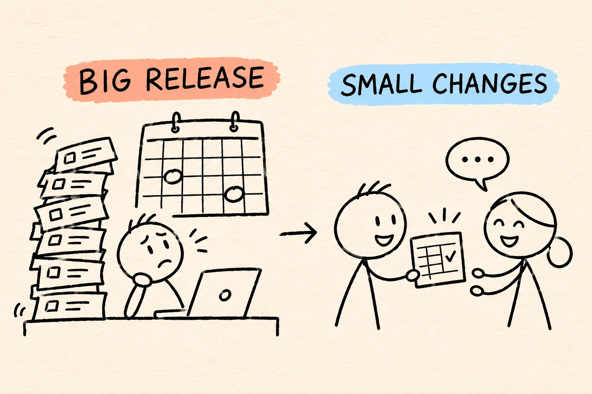

# From Two Big Releases a Year to 2.4 Deployments a Week

By Thoa Nguyen

When I joined the team in 2021, we were putting out urgent fixes every few days.

If you wanted a small improvement to the same software, there were two dates on the calendar for the whole year. Miss one, and you could spend months doing the same work the hard way.

Most of those fixes landed with two senior developers. Aaron was one of them. When he picked up a fix, his work on the next big release had to wait.

I asked the business leads and the developers why new features had to wait. Both groups figured that was just how it worked. The business leads would have been happy to get something useful sooner. Could we get one small change to them before the next big release?

## We started with a spreadsheet

The business team was already using Excel to work around a problem. I picked that one. We could see how people did the work, agree on a small first version, and keep the spreadsheet as a fallback.

Three weeks later, we had a demo. The people doing the work in Excel wanted to use it.

The testers were already booked, and the version they were testing included other changes planned for the big release. To send out our feature on its own, we needed to see how it worked with the software people were using that day.

I worked with Li and another tester to decide what could wait. We set up a separate place to test the feature against the version our users already had. People from the business tried it before launch.

The feature went live ahead of the big release. We started hearing what people thought straight away. That’s how our DevOps journey started.

## Could we do that again?

I asked the developers to take turns handling urgent fixes and agree on which problems needed immediate attention. That gave Aaron and the other developer more time for planned work.

We also took one wait out of testing. Testers used to wait for a developer to install each new version for them. We automated that step. When developers merged a change into the shared code, it went straight to the right test environment.

In 2025 and early 2026, we averaged **2.4 deployments a week** to the live system, including urgent fixes and deployments done by hand. By then, we needed far fewer urgent fixes, and the share of proposed code changes reviewed by another developer had risen from **70% to 98%**.

Over those years, we got better at judging which problems mattered to users, deciding what belonged in a first version, and automating the steps we repeated with each release.

Next time, I’ll go back to the interruptions that kept pulling Aaron away from his work. **What actually counts as urgent?**

*Names have been changed.*
